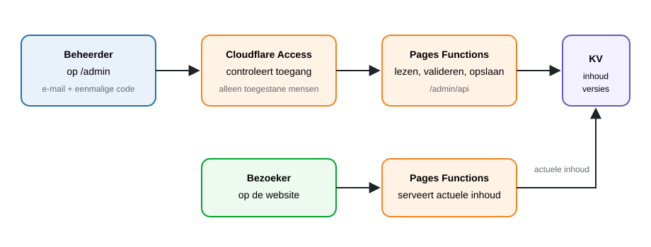

# Webcraft

Webcraft is een zelfstandig beheersysteem voor statische websites. Beheerders werken op `/admin`, terwijl de openbare website snel en eenvoudig blijft.



De standaardopzet gebruikt volledig Cloudflare:

- **Inloggen:** Cloudflare Access met een eenmalige code per e-mail.
- **Opslaan:** Cloudflare KV; wijzigingen staan direct online.
- **Rechten:** de eerste beheerder wordt admin en kan redacteurs of extra admins toevoegen.
- **Geschiedenis:** de laatste tien versies van tekstinhoud kunnen vanuit het beheer worden teruggezet.

Er is geen WordPress, database, plug-in of GitHub-inlog nodig.

## Wat zit erin?

- pagina's, berichten, concepten, foto's en downloads beheren;
- een visuele teksteditor met veilige HTML-opschoning;
- eigen formulieren en collecties, zoals een menukaart of openingstijden;
- waarschuwingen bij gelijktijdig wijzigen;
- rollen voor admins en redacteurs;
- een responsive beheeromgeving in het Nederlands.

## Zo werkt de Cloudflare-opzet

`/admin` wordt beschermd door Cloudflare Access. Een beheerder vult het e-mailadres in en ontvangt een eenmalige code. Na de toegangscontrole leest en schrijft het beheer via Pages Functions naar Cloudflare KV. De website leest de actuele inhoud vervolgens uit KV.

```
beheerder → Cloudflare Access → /admin → Pages Functions → KV
bezoeker  → website → Pages Functions → KV
```

De Functions valideren elk bestand, accepteren alleen inhoud en media op toegestane paden, en weigeren verouderde versies zodat wijzigingen van collega’s niet worden overschreven.

## In gebruik nemen

1. Maak een Cloudflare Pages-project voor de website.
2. Kopieer `cloudflare/functions/` naar de hoofdmap van de website en maak de sitespecifieke `functions/_lib/site.js`.
3. Maak een KV-namespace met de binding `WEBCRAFT_DATA`.
4. Zet in `admin/config.json` minimaal `"storage": { "api": "/admin/api" }`.
5. Bescherm `<jouwdomein>/admin` met een Cloudflare Access-applicatie, met **One-time PIN** als inlogmethode.
6. Stel `ACCESS_TEAM` en `ACCESS_AUD` in als Pages-variabelen. Zie [cloudflare/LEESMIJ.md](cloudflare/LEESMIJ.md) voor de volledige stappen.

De eerste persoon die met Access binnenkomt, wordt admin. Voeg daarna andere beheerders en redacteurs toe in **Gebruikers** in het beheer.

## Lokale ontwikkeling

Je hebt Node.js 20 of nieuwer nodig. Er zijn geen externe npm-pakketten vereist.

```powershell
npm run dev
```

Open daarna `http://localhost:8080/admin/`. Voor een volledige lokale Cloudflare-test staat de werkwijze in [cloudflare/LEESMIJ.md](cloudflare/LEESMIJ.md).

## Controleren

```powershell
npm run lint
npm test
npm run build
```

De linter controleert onder meer op geheimen en ongeldige configuratie. De tests dekken de editor, inhoudsregels, Cloudflare-opslag, rollen en versieherstel.

## Mappen

```
admin/        beheeromgeving
cloudflare/   Pages Functions, Access-controle en KV-opslag
content/      voorbeeldinhoud
sites/        voorbeeldconfiguratie voor een restaurant
templates/    HTML-sjablonen voor een eenvoudige voorbeeldsite
static/       vaste bestanden voor die voorbeeldsite
tests/        automatische tests
```

## Rechten

© 2026 Webcraft. Alle rechten voorbehouden.
